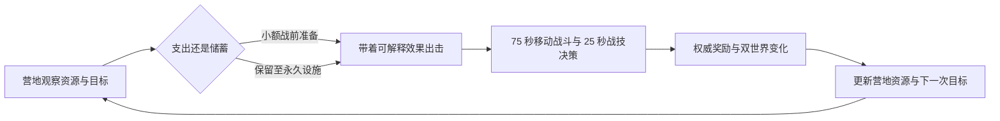

# 灵灾出击 2K · 《完美国度》参考拆解与最小经营—战斗闭环

> 2026-11-18。参考作品由用户提出；研究基线为 2J 已集成的隔离 [PR #74](https://github.com/anlew07/learn/pull/74)，HEAD `7e6cd2ee91574ab837f6931f3fc38a5e298ed70e`；联合 [CI #44234041932](https://github.com/anlew07/learn/actions/runs/44234041932) success（344 Vitest / 106 Playwright）。此文档是**产品研究与候选契约**，不是已实现的新玩法，也不批准更改正式存档或发布。

## 一、参考对象与信息依据

《完美国度》（张三工作室）TapTap：[官方游戏页](https://www.taptap.cn/app/734014) · [官方介绍与更新](https://www.taptap.cn/app/734014/all-info)。

官方介绍的明确循环是**采集资源 → 修建建筑 → 扩充人口和生产资源 → 解锁科技/兵种 → 进行模拟战争**。攻略与玩家评论体现“建设养军队、战斗拓展资源获取”的双向路径：

- [玩家新手提速攻略](https://www.taptap.cn/moment/690364125078880959)：基建涉及人口、产业、科技；军队与副本/征战构成另一侧，早期资金分配需要在生产和军事之间权衡。
- [玩家推荐与优缺点](https://www.taptap.cn/moment/816045670589795769?group_id=875125)：认可经营和战斗相互驱动，同时指出开局重复点击、成长周期过慢、信息繁杂、引导不足的问题。
- [开荒体验与具体负反馈](https://www.taptap.cn/moment/646325045349584580)：起始靠采集解锁功能，较长时期会进入等待资源与采集时间的循环，不能用“长期内容很多”掩盖短期可玩性不足。

以上来自游戏介绍与公开玩家帖子，并非经反编译、源码审计或完整实机验证；玩家攻略和评价带有主观性。**只借鉴公开的资源反馈与选择逻辑**，不复制文本、画面、UI 排版、世界观、建筑/兵种名、程序代码或游戏资产，也不推断其底层算法。无须引入联机、公会/PVP、长期付费等待或大型游戏引擎。

## 二、本项目 2J 的事实：玩法收益为何仍不成立

现有 2G/2J 隔离原型：每场 **75 秒**，**25 秒战技选择自动暂停**；灵刃自动攻击、移动闪避、拾取碎片，战后 `Engine.settleSortie` 权威重放并推进灵灾/废土两世界各一天，独立试验档与正式档隔离。

当前关键数值来自 `src/config/sortie-data.js`：
- 每击退 3 敌产生 1 碎片；**28px** 拾取半径、3 碎片换 1 灵石，最多兑换 **2** 灵石；获胜生存基础奖励 **3** 灵石。高效率主动拾取脚本常常在多种候选下都赚满 **5 灵石**，更多伤害无法额外兑现奖励。
- 护灵剑台花费 **6 灵石**，灵刃伤害 **1→2**，但 2I-C 六场 518 个真实建成配对样本 **0 个回本**；第六场累计灵灾资源差 **−6.618**。
- 2J-C 单变量仅已建剑台攻速 **0.70→0.63s**，第六场净差 **−6.627**，仍 **0/518** 回本。2J-A 雷击提前解除威胁、2J-B 掉落偏向敌群都未建立稳定的可兑现收益，运行时已还原。
- 2J-D 已让玩家看清 75 秒目标、暂停/战技、掉落与结算、营地成长；**信息更清楚不等于玩法已有效**。

因此不可再把“更多命中/击退/更远掉落/更快攻击”直接当作设计成功。需要明确 **玩家的决定影响什么、为何值得花资源、下一场是否有可观察差异**。

## 三、2K 最小 3–5 分钟纵向体验契约（候选）

不扩展成大型科技树；**先在两个连续出击之间做出一个真实可比较的经营决策**：

1. **营地首屏有一个明确目标。** 玩家知道本次出击为什么去、所需时间、可能获得资源，且看见目前缺什么建设材料；不要求阅读大量条款。
2. **第一次真实 75 秒出击**：移动/避险/接近掉落，25 秒时可见战技选择和冻结计时；过程出现至少一个可感知且不虚构的资源或风险反馈。
3. **战后真实权威回执**：灵石来源拆成存活奖励/碎片兑换，双世界的资源/风险/救援进度清楚呈现；重复结算不得重复获得任何资源。
4. **立即有可执行的资源抉择**：首场胜利获 3–5 灵石时至少允许“现在做一次小额有期限的出击准备”或“保留资源积累到 6 灵石的永久剑台”，而非只展示一个暂不可建按钮。**小额方案是待验证设计假设**，不是批准的建筑或永久消费规则。
5. **第二次真实出击检验投入效果**：建设/准备与不投资使用相同固定种子、危险档、战技与路线；不仅比多发射几次，更比受击、余命、胜败、可拾取碎片、权威灵石以及对另一世界的影响。
6. **下一目标自然而然解锁**：前两次完成后玩家看懂为什么还要继续探索、为什么保留/投入资源以及后续进度，而不是靠新弹窗和无意义红点拉长时长。

设计的简图：

## 四、实验候选及明确不做的事

2K-B **出击目的与实得价值**（只做独立候选实验）：
- 优先对现有奖励上限、击退与碎片产出、敌群/弹道、误操作下受击进行分层归因。设计**最多一个**能由战斗行动改变实际结果的“出击任务/资源回收”候选；必须让“保命绕场”和“冒险取资”产生真实、可归因的权衡，而非给捡拾直接扣血或直接加倍奖励。
- 第一个机制必须保留现有奖励上限/经济作为对照；若需扩大上限，单独作为下一轮实验，不能与新目标同时调整。暂不修改 `src/engine.js` 或 `src/systems/sortie-session.js` 的生产逻辑。

2K-C **营地消费与下一场效果**（只做独立候选实验）：
- 优先对照一个短期消费与现有 6 灵石永久剑台，举例为 **3 灵石的一次性护卫/补给准备**，必须下一次出击有可量化作用且不会免费叠加或永久赠送。**成本 3、效果与名称均为测试假设，不是正式批准方案**；不应破坏聚灵阵纹独立防御价值。
- 必须真实运行费用扣除、一次性效应耗用、`Engine.settleSortie` 双世界权威回执、再次出击和刷新/重复请求。验证消费是否值得、是否使所有玩家被迫单一路线。不得绕过回放防伪或在视图临时加资源。

2K-A **设计和基线总控**：
- 继续补充用户可观察的闭环目标、对照指标、最小测试矩阵与各线共享契约。独立起草而不是让 B/C 在未经验证时改动世界经济。
- A 是只读设计/分析工作线，不与 B/C 同时修改生产代码。

不做：**无授权的离线生产、挂机时钟与补发奖励、PVP/联盟/网络服务器、付费经济、新世界、新一整棵科技树、大规模 UI 重画、存档清除/迁移、正式页直接部署。**

## 五、2K 验收门槛

| 门槛 | 最低要求 | 明确失败 |
|---|---|---|
| 玩家第一场之后有选择 | 真实权威结算后可支持至少一个有明确预期收益的小额投入或明确说明为何储蓄更优，且在第二次出击能观察到作用 | 一个不可点击的“6 石剑台” + 只好再刷一次 |
| 策略对照 | **40 固定种子 × D0/40/75 × 雷/纹 × 绕场/主动/反向误操作**，配对比较新增短期/永久/不投入路线，报告真正可继续出击分母 | 仅凭 UI 文案、攻击次数或损伤代理定义收益 |
| 经营价值 | 使用实际支出与权威双世界结算，看累计资源净差、胜败翻转、余命、可继续出击率、每场首次可见增长 | 只把伤害翻倍视作回报或用会计假设加回费用 |
| 可选而非唯一最优 | 至少能观察到两种路线在不同危险度或目标下各有优势；单一路线全面劣化就拒绝候选 | 所有玩家被迫购入同一物品 |
| 新手信息优先级 | 320×568 / 390×844 / 430×932 看得见任务、花费、选技、真实收益和第二次出击增益；操作能直接触达 | 只能靠滚到底或自动滚动才能点到关键按钮 |
| 正确性 | 存档兼容、回放可重现、消费幂等、重复结算不重复奖励、刷新中断回退、正式档隔离；完整 CI | 绕开 `Engine.settleSortie` 或复制出独立不可验证的奖励系统 |

固定种子脚本 ≠ 真人胜率；模拟触控 ≠ 真机手感。主要做法是**先拒绝无实质收益的机制，再谨慎上线有价值的机制**。2K 不直接改动 #74 的运行时，三条线各自 Draft PR，最终由总控在隔离分支联合验收后决定下一步是否扩大玩法。

## 六、技术与版权边界

- 技术栈保持 Vite + 原生 JS + HTML/CSS + Canvas2D + Vitest/Playwright + idb-keyval；优先复用 `scripts/sortie-experiment.mjs`、`scripts/sortie-forge-roi-2h.mjs`、`scripts/sortie-forge-horizon-2i.mjs`、已有 `src/systems/sortie-session.js` 的建造幂等与 `Engine.settleSortie` 权威回放，不额外引入大型框架或后台。
- 新增经济或存档状态必须有版本兼容方案和精确状态合同；未获产品批准前仅在独立试验分支中测试。
- 参考游戏的普通玩法概念可以启发自有设计，**不采用其受版权保护的具体表现**；不要搬运画面、资产、地图、角色、文案或逆向其封闭源码。